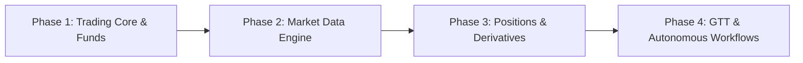

# Milotic MCP Feature Roadmap & Competitive Analysis

This document outlines the comparative analysis of **Milotic MCP Server** against popular Indian brokerage MCP implementations (**Zerodha Kite MCP**, **Dhan MCP**, and **HDFC Securities MCP**), identifying functional gaps and laying out a prioritized implementation roadmap.

---

## 1. Feature Comparison Matrix

| Feature Domain | Existing Milotic MCP | Zerodha Kite MCP | Dhan HQ MCP | HDFC Securities MCP |
| :--- | :--- | :--- | :--- | :--- |
| **Authentication & Health** | Session initiation, TOTP verify, ping/health | API Key / Enctoken session login, user profile | Access token / Client-ID auth, IP validation | API Gateway session / 2FA login |
| **Instrument Discovery** | ❌ None (must know exact token/symbol) | Search instruments, CSV dump lookup, master contracts | Search scrip master, security details by exchange token | Scrip master query, company search by ISIN / ticker |
| **Market Data (Live)** | ❌ None | `get_quote`, `get_ltp`, `get_ohlc` | `get_market_quote`, `get_ltp`, live price subscription | `get_quote`, real-time snapshot, market feed |
| **Market Data (Historical)** | ❌ None | Minute/Daily candles (`get_historical_data`) | Daily & Intraday historical candles (1/5/15/25/60m) | Historical daily/intraday chart data |
| **Market Depth (L2)** | ❌ None | Best 5 bids/asks (depth) | Best 5 bids/asks (depth) | Best 5 bids/asks (depth) |
| **Derivatives / F&O** | ❌ None | Option chain derivation, expiry lookup | `get_option_chain`, Option Greeks (Delta/Theta/Gamma/IV) | Option chain, PCR, open interest analytics |
| **Funds & Margins** | ❌ None | Available cash, collateral, margin calculator per basket | Fund limits, equity margin, commodity balance | Margin limit query, ledger balance |
| **Holdings (Long-Term)** | `books_get_portfolio` (CNC equity) | `get_holdings` (equity + mutual funds) | `get_holdings` + collateral / pledged units | Demat holdings & DP valuation |
| **Positions (Intraday & F&O)** | ❌ None (only long-term holdings) | `get_positions` (Day / Net positions with live MTM) | `get_positions` (Day / Net with MTM, realized/unrealized P&L) | Open positions, MTM valuation, squaring off |
| **Position Conversion** | ❌ None | `convert_position` (CNC ↔ MIS, NRML ↔ MIS) | `convert_position` (Intraday ↔ Delivery) | Position conversion |
| **Basic Orders** | Place (LIMIT, MKT), Cancel, Order status, List orders | Place, Modify, Cancel, Order status, List orders | Place, Modify, Cancel, Order status, Order slice | Place, Modify, Cancel, Order book query |
| **Advanced Orders (SL / GTT)** | ❌ Stop-Loss trigger, GTT, BO/CO missing | Stop-Loss (SL, SL-M), GTT (Good-Till-Triggered), Iceberg | Stop-Loss, Forever (GTT), Bracket (Super Order) | Stop-Loss, Cover/Bracket order, AMO |
| **Trade Book / Fills** | ❌ None (only order records) | `get_trades` (execution fill details, average fill price) | `get_trade_book` (fills with timestamps and fees) | Trade book execution query |
| **Advisory & Nudges** | `research_for_portfolio`, `research_get_recommendations`, `market_get_nudges` | ❌ None (pure broker execution) | ❌ None (pure broker execution) | ❌ Proprietary research reports (not in MCP) |

---

## 2. Key Gaps in Milotic MCP

### A. Market Data & Scrip Discovery
1. **Instrument Search & Lookup (`market_search_instruments`)**: Currently, users must supply an exact exchange token or symbol without discovery tools. Searching by ticker, company name, or ISIN is needed.
2. **Live Quotes & LTP (`market_get_quote`, `market_get_ltp`)**: Essential for an LLM agent before placing a limit order to evaluate current market price, bid-ask spread, and open-high-low-close.
3. **Historical Candles (`market_get_historical_data`)**: Required for technical analysis, momentum indicators, and trend detection across multiple candle resolutions (1m, 5m, 15m, 1d).
4. **Market Depth / L2 Book (`market_get_depth`)**: Top 5 bid/ask levels with volumes to assess liquidity and slippage for large orders.
5. **Derivatives & Option Chains (`derivatives_get_option_chain`)**: Expiry lists, strikes, open interest, and implied volatility/Greeks.

### B. Account, Margins & Profile
1. **Funds & Available Margin (`account_get_margins`)**: Essential for pre-order validation so the agent does not place orders that reject due to insufficient funds.
2. **Order Margin Calculator (`account_calculate_margin`)**: Pre-trade margin requirement calculation across single orders and multi-leg baskets.
3. **User Profile & Session Details (`account_get_profile`)**: Client ID, KYC status, exchange enablement flags, segment permissions.

### C. Positions & Portfolio Management
1. **Net & Day Positions (`positions_get_open_positions`)**: Crucial for intraday (MIS) and derivative (NRML) positions with live Mark-to-Market (MTM) calculations.
2. **Position Conversion (`positions_convert`)**: Ability to convert positions between intraday (MIS) and overnight/delivery (CNC/NRML).
3. **Mutual Fund & Gold Holdings (`books_get_mf_holdings`)**: Broader portfolio coverage beyond direct equity.

### D. Advanced Order Placement & Execution
1. **Stop-Loss Support (`trading_place_order` extension)**: Adding `trigger_price` and order types `SL` (Stop Loss Limit) and `SL-M` (Stop Loss Market).
2. **Order Modification (`trading_modify_order`)**: Adjusting price, quantity, or trigger price of open / pending orders without having to cancel and recreate.
3. **Trade Book (`trading_get_trades`)**: Detailed execution logs showing partial/complete fills, timestamps, and actual executed trade prices.
4. **GTT / Conditional Orders (`trading_place_gtt`)**: Good-Till-Triggered orders for passive stop-loss and take-profit targets across days/weeks.

---

## 3. Milotic Competitive Advantage

Unlike Kite, Dhan, or HDFC MCPs (which are purely transactional execution APIs), Milotic provides:
- **Built-in Research & Recommendations**: Sectoral and scrip-level calls (`research_get_recommendations`, `research_for_portfolio`).
- **Market Nudges**: Event-driven nudges and alerts matched directly against user holdings (`market_get_nudges`, `market_nudges_for_portfolio`).

By combining intelligent advisory with complete broker-grade execution and market data, Milotic can operate as a full autonomous advisory-and-trading copilot.

---

## 4. Phased Implementation Roadmap

### Phase 1: Execution Hardening & Account Safety (High Priority)
- [ ] Add `account_get_margins` to query available balance and collateral.
- [ ] Implement `trading_modify_order` (modify price, quantity, trigger price).
- [ ] Add Stop-Loss support (`SL` / `SL-M` with `trigger_price`) to `trading_place_order`.
- [ ] Implement `trading_get_trades` for fill logs and average fill price.

### Phase 2: Market Data & Instrument Discovery (High Priority)
- [ ] Implement `market_search_instruments` (search scrips by symbol, name, ISIN).
- [ ] Add `market_get_quote` and `market_get_ltp` for live price verification.
- [ ] Add `market_get_historical_data` for candle time-series data.
- [ ] Add `market_get_depth` (L2 5-depth order book).

### Phase 3: Positions & Derivatives (Medium Priority)
- [ ] Implement `positions_get_open_positions` (day/net intraday & F&O with MTM).
- [ ] Implement `positions_convert` (MIS ↔ CNC / NRML).
- [ ] Implement `derivatives_get_option_chain` with strike ladder and open interest.

### Phase 4: Conditional Orders & Advanced Automation (Low Priority)
- [ ] Implement GTT / Forever conditional orders (`trading_place_gtt`, `trading_get_gtt`).
- [ ] Basket order margin calculation and batch execution.
- [ ] Automated portfolio rebalancing triggers combining research recommendations with GTT.
